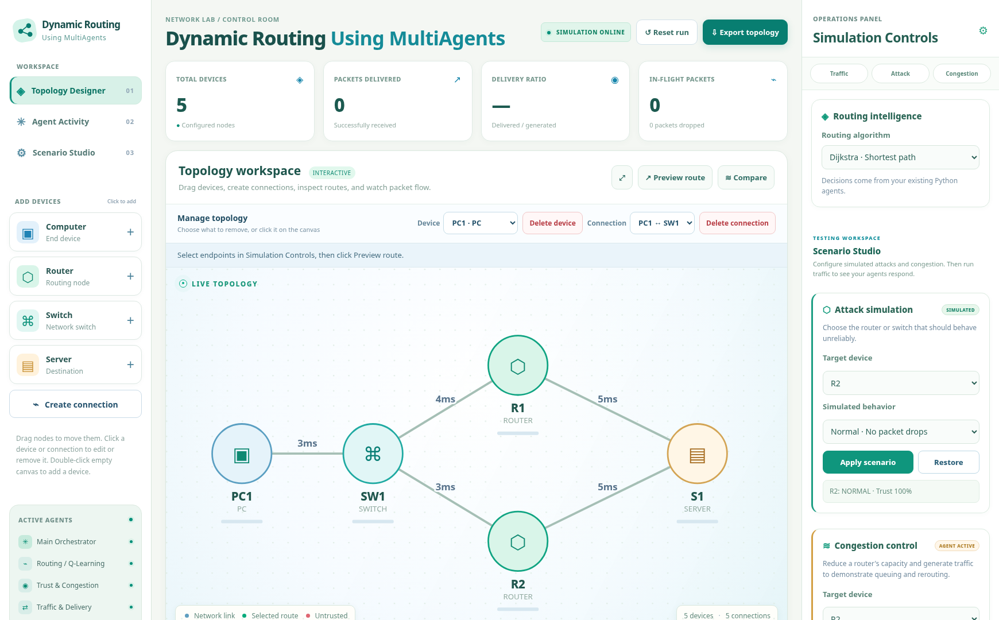

# Dynamic Routing Using MultiAgents

An interactive **Python-based multi-agent network routing simulator** featuring intelligent route selection, adaptive trust scoring, congestion management, and an optional natural-language mission planner.



> **Prototype status:** Educational network simulation, not physical router configuration or real intrusion detection. Simulated blackhole / grayhole behavior is contained within this application.

## Features

- **Interactive topology designer:** Add/remove PCs, switches, routers, and servers; create/delete links; drag devices and edit properties.
- **Main Agent orchestration:** The Main Agent coordinates specialized agents, each following **Assess → Plan → Act → Check**.
- **Routing:** Dijkstra baseline and experimental Q-Learning routing with route comparison.
- **Traffic simulation:** Packet generation, processing queues, forwarding capacity, congestion, and delivery metrics.
- **Trust-aware routing:** Simulated forwarding anomalies change trust scores and can trigger avoidance of unreliable routers.
- **Scenario controls:** Blackhole/grayhole simulation, overload, restoration, congestion thresholds, and traffic presets.
- **AI Orchestrator:** Natural-language mission planning with a review-and-approve workflow. Offline rule-based interpreter is the default; Gemini interpretation is optional.
- **Animated frontend:** Light-themed dashboard with network animation, agent events, and status charts.
- **Topology persistence:** Import/export JSON network configurations; sample `topology.json` included.

## Quick start (Windows)

1. Install [Python 3.10+](https://www.python.org/downloads/) and open this folder in VS Code.
2. Start the dashboard:

   ```powershell
   py server.py
   ```

   Or double-click `start_dashboard.bat`.
3. Open **http://127.0.0.1:8765** in your browser.
4. Load the example topology or create your own network in the designer.

**No third-party Python packages or internet access are required for offline mode.** Ensure port 8765 is available. To stop the server press `Ctrl+C`.

## Optional Gemini API

The Gemini API is **optional**; the simulator works without it. Set the key only in your local terminal:

```powershell
$env:GEMINI_API_KEY = Read-Host "Enter Gemini API key"
py server.py
```

The environment variable exists only in that PowerShell session. **Never commit API keys, `.env` files, or secrets to GitHub.** The AI integration interprets tasks; the Python agents and simulator remain responsible for routing and packet execution. This release does *not* use Google ADK delegation.

## Test

Run automated tests from the repository root:

```powershell
py -m unittest discover -v
```

Demo scripts:

```powershell
py demo_step3.py
py demo_step4.py
py demo_step5.py
```

## Files and architecture

| File | Purpose |
|---|---|
| `server.py` | Serves dashboard and handles approved API requests |
| `network.py` | Network topology, devices, links, and configuration |
| `agents.py` | Main Agent and specialized agents |
| `traffic.py` | Packet simulation, queues, congestion and delivery results |
| `qlearning.py` | Experimental Q-Learning routing |
| `mission_agent.py` | Validated mission planner and optional Gemini support |
| `web/` | HTML, CSS, JavaScript and animated UI |
| `topology.json` | Sample network used for demonstrations |
| `test_*.py` | Automated project tests |

### Agent workflow

The Main Agent delegates tasks to specialized agents. Each specialized agent follows:

```text
Assess → Plan → Act → Check
```

This supports independent extension of trust management, routing, traffic generation, and congestion handling.

## Example walkthrough

1. Load the sample topology: `PC1 → SW1 → {R1, R2} → S1`.
2. Select Q-Learning or Dijkstra in the routing controls.
3. Preview route `PC1 → S1`, then simulate packet traffic.
4. In Scenario Studio, simulate blackhole behavior on an active forwarding router.
5. Monitor router trust values and watch a new route be selected if a trusted alternative exists.
6. Use **Manage Topology** to add `PC2` via `SW1`, test `PC1 → PC2`, or delete devices and links.

**Note:** PCs and servers are endpoints; they do not forward transit packets in this simulator. Packet drops due to congestion are recorded separately from unexplained forwarding losses. An untrusted router does not prove a real compromise.

## Limitations and next steps

- Discrete simulation only; not a Cisco Packet Tracer replacement.
- Q-Learning performance gains are not guaranteed; compare algorithms under controlled experimental scenarios.
- The Gemini integration is optional and is not Google ADK.
- Plans require explicit approval before affecting the simulation.
- Future work: formal performance benchmark suite, richer agent traces, optional LLM orchestration, expanded router/device models and improved visualization.

## Collaboration

For teammates, fork or clone the repository, create a feature branch for changes, and submit a pull request for review. Discuss architecture changes before merging into `main`.
